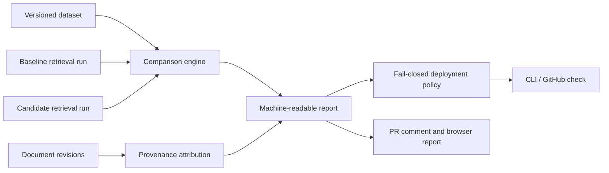

# RAGDiff

RAGDiff is a Python toolkit for detecting retrieval regressions caused by changes to a knowledge base or retrieval pipeline. It compares two versioned retrieval runs on the same labeled dataset, reports query-level evidence, and applies a fail-closed deployment policy.

> Portfolio MVP: a reliability-engineering case study, not a claim of production maturity.

## Why this exists

Generic RAG evaluation answers whether a run is good. RAGDiff focuses on what changed and which queries became unsafe to deploy. Its public evidence is intentionally reproducible:

- typed Python domain contracts for datasets, retrieval runs, comparisons, and reports;
- deterministic regression decisions with incomplete evaluations blocked by default;
- document revisions, chunk provenance, and plausible-cause attribution;
- tenant-scoped FastAPI APIs, bearer authentication, and a browser report surface;
- PostgreSQL/pgvector adapters, Docker runtime, OpenTelemetry request tracing, and AWS Terraform topology;
- pull-request evaluation, downloadable JSON artifacts, and idempotent bot summaries.

## Quickstart

Requirements: Python 3.12+, [`uv`](https://docs.astral.sh/uv/), or Docker.

```bash
uv sync --locked --extra dev
uv run --locked ragdiff \
  --dataset examples/evaluation/dataset.json \
  --baseline examples/evaluation/baseline.json \
  --candidate examples/evaluation/candidate.json \
  --output /tmp/ragdiff-report.json \
  --k 10
```

The command prints an `allowed` decision for the clean fixture. The case study intentionally exits with status `1` because its candidate contains one measured regression:

```bash
uv run --locked ragdiff \
  --dataset examples/case-study/dataset.json \
  --baseline examples/case-study/baseline.json \
  --candidate examples/case-study/candidate.json \
  --output /tmp/ragdiff-case-study-report.json \
  --k 10
```

Run the API in Docker:

```bash
docker compose up --build api
curl http://localhost:8000/health
```

The container runs as the non-root `ragdiff` user and exposes a health check. The `evaluation` Compose profile runs the same immutable image as a batch worker.

## Architecture



The core comparison layer is pure domain logic. Adapters handle PostgreSQL/pgvector persistence and embedding providers. FastAPI is an application boundary; it does not decide deployment status from client-provided fields. The policy derives status from the report server-side.

Current AWS topology is Terraform-defined: public ALB, private ECS Fargate tasks, private encrypted PostgreSQL, Secrets Manager, CloudWatch logs, and least-privilege task execution access. Actual provisioning is intentionally not performed by local development.

## Evaluation workflow

The pull-request workflow:

1. loads a controlled dataset and baseline/candidate retrieval runs;
2. computes query-level recall changes and report summaries;
3. exits non-zero when the deployment policy blocks a regression;
4. uploads the JSON report;
5. creates or updates one marker-based bot comment with the decision evidence.

The comment is idempotent. Report-derived reasons are escaped before Markdown rendering. Workflow permissions are limited to repository read and pull-request comment write access.

## Case study

[`examples/case-study`](examples/case-study) contains synthetic maintenance documents, retrieval runs, a provenance manifest, a measured report, and benchmark output. The change removes a green-valve inspection instruction. The fixture shows:

- one unchanged query with Recall@10 of 1.0;
- one regressed query with Recall@10 changing from 1.0 to 0.0;
- the changed chunk associated with the affected query;
- a diagnostic hypothesis explicitly labeled as a plausible cause, not proof.

The benchmark records quality counts, comparison latency, estimated cost metadata, package/Python versions, and pipeline versions. Latency is machine-dependent; the quality and configuration evidence is deterministic.

## Development checks

```bash
uv run --locked ruff check .
uv run --locked ruff format --check .
uv run --locked mypy src tests
uv run --locked pytest -q
```

Database integration tests are skipped unless `RAGDIFF_TEST_DATABASE_URL` is set. Docker and Terraform checks are run independently in isolated containers.

## Security and limitations

- Authentication uses hashed bearer tokens and tenant-scoped queries; tokens and request bodies are excluded from telemetry.
- PostgreSQL credentials are not committed. Terraform generates a staging secret and stores it in Secrets Manager; production secret rotation and IAM review remain required work.
- The Docker vulnerability scan currently reports unresolved upstream HIGH/CRITICAL findings in the base image and dependencies. This is recorded rather than hidden; production use requires remediation or a documented exception.
- Causal attribution is evidence-based and intentionally probabilistic. A changed chunk linked to a regressed query is a diagnostic lead, not a causal proof.
- The MVP does not yet provide a hosted public environment, billing controls, full reranking benchmarks, or a mature multi-region operational model.

## License

MIT.
